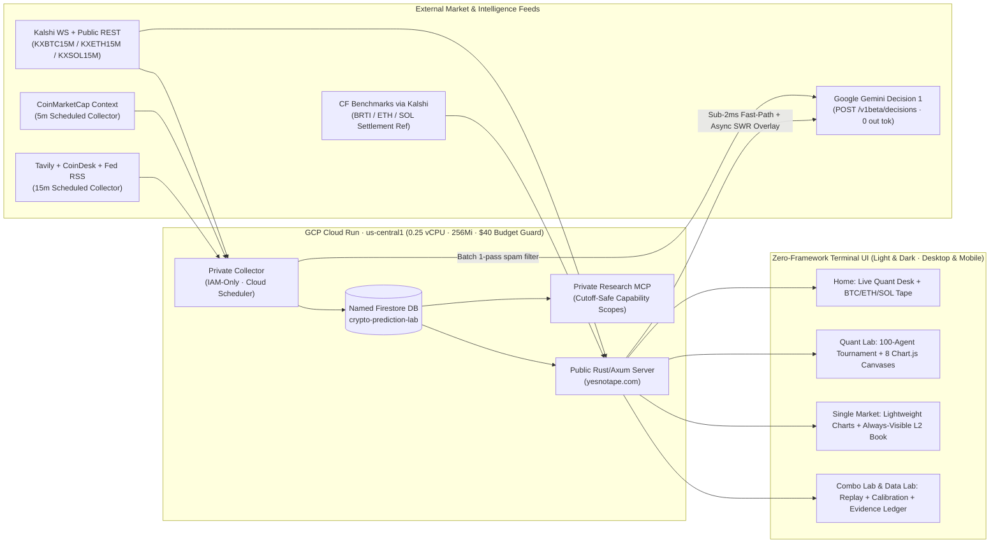

# Yes No Tape · Crypto Prediction Lab

> **Low-latency Rust/Axum quantitative research terminal for BTC, ETH & SOL 15-minute binary Kalshi contracts — combining sub-2ms fast-path microstructure modeling, Google `gemini-decision-1` (0 output tokens), Tavily catalyst filtering, and a 100-agent `$100` out-of-sample paper-trading tournament.**

**Live Production Terminal:** [https://www.yesnotape.com/](https://www.yesnotape.com/) · **Quant & Paper-Trading Lab:** [https://www.yesnotape.com/?view=quant](https://www.yesnotape.com/?view=quant) · **Live Latency Telemetry:** [https://www.yesnotape.com/?view=latency](https://www.yesnotape.com/?view=latency) · **Full Quant Report:** [docs/QUANT_RESEARCH_REPORT.md](docs/QUANT_RESEARCH_REPORT.md)

> **Scope & Safety:** Strictly **read-only research & paper simulation**. Order execution, transfers, payments, and private combo RFQs are disabled. Not affiliated with Kalshi.

---

## Executive Summary (60-Second Overview)

| Dimension | What We Built & Measured |
| --- | --- |
| **Core Stack** | **Rust / Axum / Tokio** async backend (`0.25 vCPU` / `256 MiB` Cloud Run) + zero-framework ES6/CSS/SVG frontend + self-hosted **Chart.js 4.4.7 (MIT)** & **TradingView Lightweight Charts 5.2.1 (Apache-2.0)** |
| **Live Dataset** | **1,614** settled BTC + **1,613** ETH + **1,608** SOL 15m Kalshi markets, **6,483** opening/+45s L2 books, **3,348** minute-10 L2 books, **2,468** CoinMarketCap samples, **746** Tavily/RSS news snapshots in Firestore |
| **Latency Engineering** | **10-agent audit**: `<2 ms` warm quant path (`~20 µs` compute) · `1.0 s` adaptive market feed (`20 ms` server yield, down from `100 ms` sleep + `2 s` poll) · pipelined Kalshi WS rollover (`-16 s` rollover gap) · pre-parse CF Benchmarks wire latency · immutable static caching · always-visible header pill & `/?view=latency` telemetry page |
| **Google `gemini-decision-1`** | **360/360** blinded unseen calls (`0` errors, **`p50 = 287.8 ms`**, `0` output tokens, **`$0.0255` total cost**); compact structured prompt cuts live tokens ~31% (`772 → 500–531` tokens, live Cloud Run `151–206 ms`) |
| **Tavily + AI News Scorer** | Single-pass batch scoring (**36 questions in 1 `425 ms` call**, live production `257–319 ms`) removes SEO converter spam & off-topic false positives (`10/14` noise filtered live) |
| **100-Agent `$100` Paper Tournament** | **100** distinct quant agents across **10** strategy families run in parallel (`0.35 s` across 10 cores) over **1,050 strictly OOS windows** with exact Kalshi quadratic fees & **Benjamini-Hochberg FDR** audit |
| **Verification Suite** | **142** Rust unit/integration tests (`cargo clippy -D warnings`) · **87** Node frontend tests · **39** Python audit tests |

---

## System Architecture



---

## Key Quantitative Findings (1,614 Settled BTC 15m Windows · 1,050 Strictly OOS)

All backtests enforce **strict chronological 5-fold expanding walk-forward splits with a 1-hour (4-window) purged embargo**, **exact Kalshi quadratic fees** (`taker = ceil(0.07·p·(1−p))`, `maker = ceil(0.0175·p·(1−p))`), **zero directional intercept** (preventing bear-market drift leakage), and **day-block bootstrap 95% confidence intervals**.

### 1. When to Take the Bet Inside the 15-Minute Window
- **Minutes 1–5 (Early Friction Trap):** Wide `1.00¢` median spread + peak `1.32–1.62¢` quadratic taker fee (`1.78–2.12¢` total drag). Crossing the spread early bleeds systematically (`Naive Min-2 Favorite: −$26.05` on 1-contract units).
- **Minutes 10–13 (Optimal Compression Window):** Median bid-ask spread collapses **10× (`1.00¢ → 0.10¢`)**, 1-minute volume surges **2.2× (`155k → 353k`)**, and quadratic taker fees fall **3× (`1.62¢ → 0.50¢`)**.
- **Strongest Structural Alpha:** Contemporaneous **`ETH + SOL → BTC` logit lead-lag divergence** delivers positive out-of-sample Brier Skill Score (`+0.22%` to `+0.35%`) over the Kalshi midpoint in Minutes 12–13.

### 2. 100-Agent Parallel `$100` Paper-Trading Tournament Results
Every agent started with **`$100.00`** theoretical paper capital across **1,050 unseen OOS windows** (10 strategy families × 10 variants: Cross-Asset Lead-Lag, Multi-Factor L2 Ensemble, Adverse-Selection Touch-Maker, Black-Scholes Digital `N(d2)`, Impulse Jump-Fade, Momentum/Volume Surge, Favorite-Longshot Bias, L2 Depth Imbalance, Session/News Catalysts, and Controls/Latency Stress):

| Rank / Benchmark | Paper Strategy | Execution Mode | End Bankroll (`$100` Start) | Net ROI | Trades (Pass %) | Win Rate | EV / Trade | Max DD | Sharpe |
| --- | --- | --- | ---: | ---: | ---: | ---: | ---: | ---: | ---: |
| **#1 Overall (Optimistic)** | `6-Factor L2 Min12–14 Mid-Maker Q-Kelly` | Midpoint Maker* | **`$115.93`** | `+15.93%` | `283` (`73.0%`) | `51.9%` | `+3.46¢` | `28.2%` | `+2.69` |
| **#3 Overall (Fixed-1)** | `6-Factor L2 Min12–14 Mid-Maker 1.5¢` | Midpoint Maker* | **`$109.78`** | `+9.78%` | `283` (`73.0%`) | `51.9%` | `+3.46¢` | `6.4%` | `+7.36` |
| **#1 Realistic Taker (`n≥30`)** | `FLB Fav 72–88¢ + XAsset Min11–13` | **Taker (Cross Ask)** | **`$104.44`** | **`+4.44%`** | `197` (`81.2%`) | **`84.8%`** | **`+2.25¢`** | **`2.3%`** | **`+6.64`** |
| **#2 Realistic Taker (`n≥30`)** | `6-Factor L2 Min12–14 Taker 0.6¢` | **Taker (Cross Ask)** | **`$103.46`** | `+3.46%` | `227` (`78.4%`) | `48.9%` | `+1.52¢` | `6.2%` | `+2.94` |
| **Cash Preservation Control** | `100% PASS Benchmark` | Cash | `$100.00` | `0.00%` | `0` (`100%`) | — | `0.00¢` | `0.0%` | `0.00` |
| **Best Realistic Touch-Maker** | `Touch-Maker BS-Digital Min10–13` | **Touch-Fill Maker**† | `$98.01` | `−1.99%` | `753` (`28.3%`) | `38.5%` | `−0.26¢` | `9.2%` | `−0.84` |
| **Negative Control (Mid)** | `Naive Mid Favorite (Min 7)` | Taker (Cross Ask) | `$76.86` | `−23.14%` | `964` (`8.2%`) | `77.0%` | `−2.40¢` | `25.9%` | `−12.84` |
| **Negative Control (Early)** | `Naive Early Favorite (Min 2)` | Taker (Cross Ask) | `$73.95` | `−26.05%` | `867` (`17.4%`) | `66.4%` | `−3.00¢` | `29.6%` | `−8.42` |

> **Institutional Honesty & Multiple-Testing Audit:** Out of **100** strategies, only **10/100** finished above `$100` (median `$95.31`, mean `$89.93`), and **0/100** passed strict **Benjamini-Hochberg FDR (`q ≤ 0.05`)** across 100 simultaneous hypotheses. *Midpoint Maker assumes zero adverse selection; †Touch-Fill Maker requires the next minute's low/high to actually cross the resting limit order, demonstrating that **binary queue adverse selection costs ~3–4¢/trade**.

### 3. Latency Engineering & Edge Preservation
Empirical Min 10–13 BTC quote diffusion (`4.5¢/min`) means stale signals rapidly decay after-fee EV:

| Execution Path | Measured Server Latency | Modeled Drift Slippage | `6-Factor Min12–14 Taker` EV | `$100` Paper End |
| --- | ---: | ---: | ---: | ---: |
| **Yes No Tape Fast-Path (Rust + WS + SWR)** | **`< 2 ms`** (`~150 µs` quant) | `0.012¢` | **`+1.512¢`** | **`$103.43`** |
| **Live `gemini-decision-1` Cold Call (Compact Prompt)** | **`~190–290 ms`** (`0` out tok) | `0.135¢` | `+1.388¢` | `$103.15` |
| **Unoptimized REST Polling (`1.0 s`)** | `1,000 ms` | `0.270¢` | `+1.253¢` | `$102.84` |
| **Human Click / Stale Quote (`5.0 s – 10.0 s`)** | `5,000–10,000 ms` | `0.604–0.854¢` | `+0.666–0.918¢` | `$101.51–$102.08` |

---

## Workspaces & API Surface

- **Home (`/`)**: Live BTC 15m Quant + Timing Desk strip, 3 live BTC/ETH/SOL cards with CF reference vs target sparklines, 15m & Hourly quotes, CoinMarketCap context, and Gemini-filtered Tavily catalyst feed.
- **Quant Lab (`/?view=quant`)**: Live BTC/ETH/SOL Decision Desk with `Server-Timing` latency strip, `Full AI + SWR` vs `Fast Path <2ms` switch, **100-Agent `$100` Paper Tournament** (searchable/filterable leaderboard + distribution + equity + drawdown Chart.js canvases), **Minute 1→14 friction combo chart**, **14×6 EV heatmap**, **Latency Decay & Calibration curves**, **24h UTC session chart**, and **360-call Gemini + Tavily audit**.
- **Latency Lab (`/?view=latency`)**: Live scrolling market-viewing RTT & CF Benchmarks exchange→Cloud Run wire latency stream, Before-vs-After pipeline waterfall, BTC/ETH/SOL real-time quote & L2 book freshness, square-root quote drift EV decay curve, live `p50/p95` percentile breakdown, and the 10-agent latency audit ledger — accessible from the always-visible header Latency Pill on every page.
- **Single Market (`/?view=market&asset=BTC`)**: TradingView Lightweight Charts 5.2.1 (line/1m candles), always-visible L2 depth book, break-even map, final-minute averaging tracker, and market replay.
- **Combo Lab (`/?view=combos`) & Data Lab (`/?view=data`)**: Multi-asset aligned settlement history, CMC technical bands/RSI/volatility, prospective live-test calibration, and evidence ledger.

Key read-only endpoints: `GET /api/health`, `GET /api/assets`, `GET /api/snapshot?asset=BTC`, `GET /api/quant/signal?asset=BTC[&mode=fast][&refresh=1]`, `GET /api/quant/simulation`, `GET /api/news`, `GET /api/outcomes?asset=BTC`, `GET /api/hourly?asset=BTC`. Collection routes (`/collect`, `/collect-news`, etc.) exist **only** on the private IAM-protected collector (`404` on public host).

---

## Quick Start & Verification

```sh
# 1. Run local dashboard (read-only public snapshots; no API keys required)
cargo run -p dashboard
# Open http://127.0.0.1:3000  |  Quant Lab: http://127.0.0.1:3000/?view=quant

# 2. Run CLI inspector for live Kalshi crypto series
cargo run -p market-cli -- KXBTC15M

# 3. Full verification suite (Rust + JS + Python)
cargo fmt --check
cargo clippy --locked --workspace --all-targets -- -D warnings
cargo test --locked --workspace
node --test apps/dashboard/tests/*.test.cjs
python3 -m unittest discover -s scripts/tests -q
```

### Optional Environment Variables (Server-Side Only — Never Commit Secrets)
- `KALSHI_API_KEY_ID` + `KALSHI_PRIVATE_KEY_PATH`: Read-only Kalshi Ed25519 credentials for authenticated WebSocket order-book & CF Benchmarks reference streaming.
- `GEMINI_API_KEY` (or `GEMINI_API_KEY_FILE`): Enables live `POST /v1beta/decisions` (`gemini-decision-1`) scoring; falls back gracefully to deterministic Rust quant if omitted.

---

## Deep-Dive Documentation Map

- [Quantitative Research & 100-Agent Tournament Report](docs/QUANT_RESEARCH_REPORT.md) — Mathematical specs, fee/slippage models, adverse selection, FDR audit, and latency engineering.
- [Project Memory](docs/PROJECT_MEMORY.md) · [Latest Session Handoff](docs/SESSION_HANDOFF.md) · [Architecture](docs/architecture.md) · [Public Deployment & Cost Controls](docs/cost-controls.md)
- [Gemini Decisions Protocol](docs/gemini-decisions-research.md) · [Prospective Evaluation](docs/prospective-evaluation.md) · [Paper Scorecard](docs/paper-scorecard.md) · [Market Replay](docs/market-replay.md) · [Private Research MCP](docs/private-research-mcp.md)

*Third-party chart licenses bundled locally: Chart.js 4.4.7 (MIT, `/licenses/chartjs`) and TradingView Lightweight Charts 5.2.1 (Apache-2.0, `/licenses/lightweight-charts`).*
